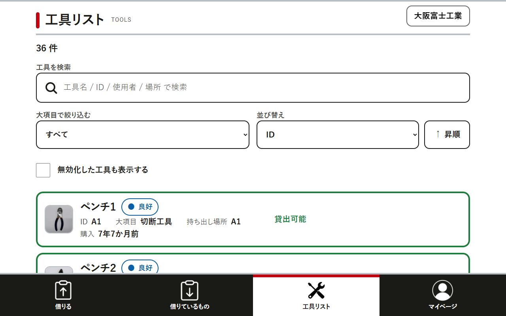
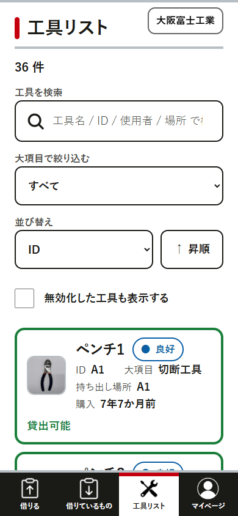
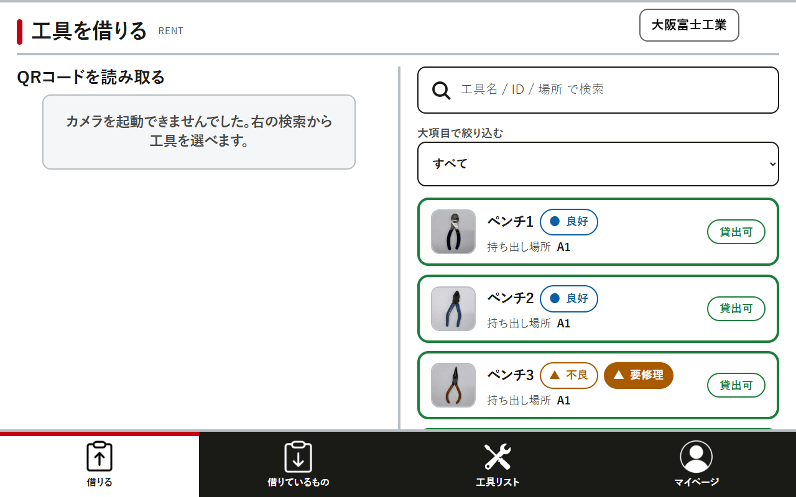
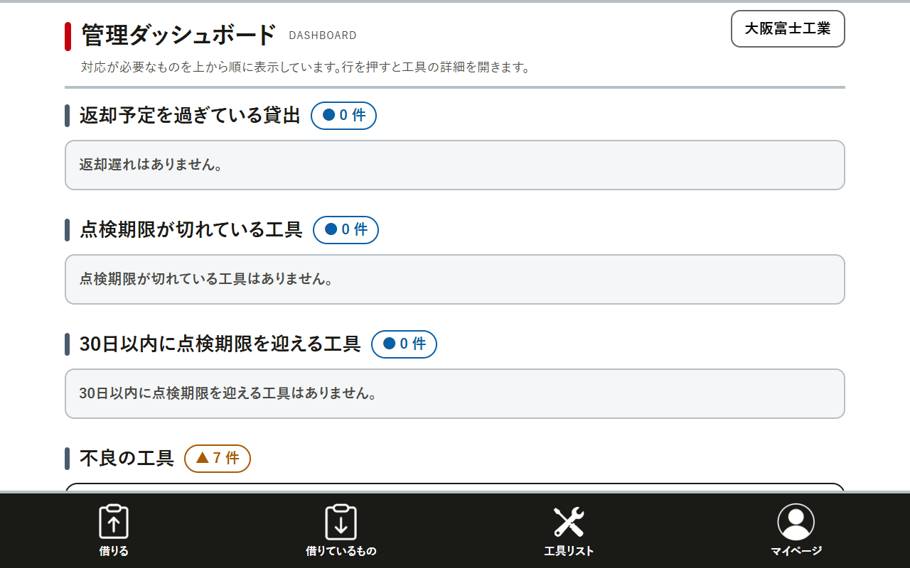

<div align="center">

# 🔧 工具管理システム

**工場の工具を「誰が・どこで・いつまで」使っているか、スマホやタブレットからすぐに分かる Web アプリ**

</div>

大学の授業「地域共創デザイン実習」で、大阪富士工業株式会社様と協働して 5 人のチームで制作した Web アプリです。
私はシステム開発を中心に担当し、タスク・スケジュール管理も行いました。

工場では、安全や品質に関わる工具の使用者・場所・状態をアナログのみで管理しており、工具を探す手間による作業の遅れが課題でした。
そこで、工具に付けた QR コードを読み取るだけで貸出・返却ができ、工具の状態や点検の記録もすぐに確認できるシステムを作りました。
企業様や教員からのフィードバックを何度も反映し、現場ですぐに導入できることを目指して改良を重ねています。

## スクリーンショット

**工具リスト**：状態（良好・不良）、持ち出し場所、購入からの経過年数を一覧で確認できます。

<table>
  <tr>
    <td></td>
    <td></td>
  </tr>
</table>

**工具を借りる**：QR コードを読み取るか、右の一覧から工具を選んで借ります。



**管理ダッシュボード**：返却遅れ、点検の期限、不良の工具などを上から順に表示します。



※ ローカルで起動し、シードの架空データで撮影しました（カメラが無い環境のため、QR の読み取り欄はエラー表示になっています）。

## 主な機能

| 画面 | 使う人 | 内容 |
| --- | --- | --- |
| 📷 **工具を借りる** | 全員 | QR コードの読み取り、または一覧から工具を選んで、今すぐ借りる・予約する。持ち出し場所はマップをタップして選ぶ |
| 📋 **借りているもの** | 全員 | 返却、返却予定の変更、引き渡し、予約の持ち出し・変更・取り消し |
| 🧰 **工具リスト** | 全員 | 状態・持ち出し場所・購入日・点検の記録・使用履歴・更新履歴を確認。点検もここで記録 |
| 👤 **マイページ** | 全員 | 社員情報、いつもの持ち出し場所の設定、パスワードの変更 |
| 📊 **管理ダッシュボード** | 管理者・班長 | 返却遅れ、点検の期限、不良の工具、ロック中の社員を一覧で確認 |
| 🛠️ **管理画面** | 管理者 | 工具・社員の追加と無効化、点検項目の管理、QR コードの発行、マップの設定、CSV の入出力 |

## 工夫したところ

### 現場で迷わない操作

- 作業用の手袋をしたままでも押せるように、ボタンなどの大きさを 64px 以上（主な操作は 72px）にそろえました
- 状態は色だけで伝えず、必ずアイコン（●▲✕）と文字を一緒に表示しています
- 赤と緑の組み合わせを避け、良好は青、不良は橙にして、色の見え方の違いに配慮しました
- QR コードを付けられない工具は、一覧から選んで借りられます

### 工具情報の見える化

- 工具ごとに、購入日と経過年数（「6年4か月前」など）、不良のランク（軽微 / 要修理 / 要買い替え / 交換待ち）と内容を記録できます
- 点検項目は管理画面で追加し、工具ごとに割り当てます。項目ごとに OK / NG を付けて記録すると、最終点検日が更新されます
- 工具情報が変わるたびに、どの項目が「変更前 → 変更後」になったかを更新履歴に残します

### 企業様のフィードバックを反映

企業相談会でいただいたご意見をもとに、次のような機能を追加しました。

- 貸出・返却を日時（時:分）まで記録し、返却予定は「日付 + 午前/午後」で指定
- 予約と貸出の期間が重なるときは、入力した時点で警告して保存させない（API 側でも拒否）
- 同じ班のメンバーなら、代わりに借りる・返す・延長・予約ができる（履歴に「代理：◯◯」と残る）
- 「置き場所」を、実際の使い方に合わせて「持ち出し場所」に名前を変更
- 全角/半角・ひらがな/カタカナ・大文字/小文字・空白の違いを区別しない検索と、大項目での絞り込み

### 実際の運用を考えた仕組み

- **権限**：管理者 / 班長 / 一般 の 3 段階。班長は自分の班の貸出状況を見られ、パスワードの初期化やロックの解除ができます
- **ログイン**：パスワードは 8 文字以上で英字と数字を含む決まりにし、5 回続けて間違えると 15 分ロックします
- **無効化**：社員や工具は削除せずに「無効化」し、過去の貸出・点検の履歴は残します
- **お知らせ**：返却予定を過ぎた貸出や点検の期限を、画面の上部に表示します
- **CSV**：工具台帳や貸出・点検の履歴を Excel でそのまま開ける形で出力でき、工具・社員の一括登録もできます
- **オフライン**：通信できないときは画面に表示し、一覧の読み込みを自動でやり直します

## 技術スタック

| | |
| --- | --- |
| **Frontend** | React 19, React Router, Vite, Tailwind CSS, Headless UI, jsQR（QR コードの読み取り）, qrcode.react（QR コードの発行） |
| **Backend** | Node.js, Express, MySQL, JWT, bcrypt, Multer（画像のアップロード） |
| **Infra** | Vercel（画面）, VPS 上の Docker（API）, Caddy, Cloudflare, GitHub Actions（テスト・ビルド） |

```
現場の社員（スマホ・タブレット）
   │  QR コードの読み取り・貸出・返却・点検
   ▼
画面（React, Vercel）
   │
   ▼
API（Express, JWT）──▶ MySQL
   │
   └─▶ 工具の写真・マップ画像、操作ログ
```

## ディレクトリ構成

```
.
├── frontend/           # 画面（React + Vite）
├── backend/            # API（Express + MySQL）
├── docs/
│   ├── development.md  # ローカルでの起動、テスト、詳しい仕様などの開発者向け情報
│   ├── operations.md   # 本番の設置・バックアップ・復旧の手順
│   └── vps.md          # VPS での動かし方
├── docker-compose.yml  # 画面・API・MySQL をまとめて動かす構成
└── compose.vps.yaml    # VPS で API だけを動かす構成
```

開発の手順や詳しい仕様は [docs/development.md](docs/development.md) にまとめています。

## Contact

- GitHub: [@Ryosei1009](https://github.com/Ryosei1009)
- Portfolio: [www.shinoryo.com](https://www.shinoryo.com)
- Mail: shinoryo1009@gmail.com
